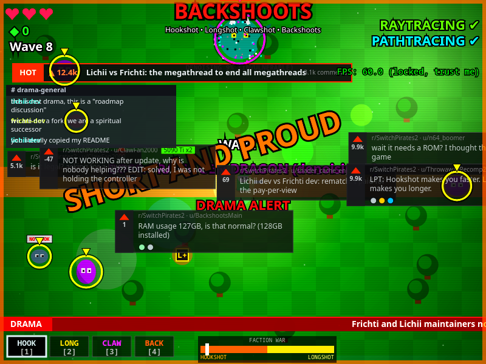

# BACKSHOOTS

**The recomp the recomps were afraid of.**

Every Zelda recomp has the same problems: pending issues, stutter, black screens, the upstream going missing. Backshoots fixes all of them by being **a single HTML file**. No shader compiling, no ROM check, no driver issues, nothing to install.

Open the link. It runs. Locked 60 FPS. I checked. The counter says so.

**▶ Play here: https://schulzcode.github.io/backshoots/**

---

## Features

- **Locked 60 FPS, everywhere.** Intel, AMD, NVIDIA, a toaster. The counter in the corner is hardcoded to 60.0, so it never drops.
- **Ray tracing.** 0 rays traced, which is why it is so fast.
- **Path tracing.** Fully enabled. Performance impact: none. You can toggle it off in Settings, but you will not see a difference.
- **DLSS 5** with neural upscaling, neural faces and Neural Upscale 8K on big kill streaks. Strength goes up to **11**.
- **Frame Generation 4x.** 3 out of 4 frames are fake. The game tells you when.
- **Raytraced lens flares, global illumination and reflections.** Some of these are real circles.
- **A fully functional settings menu** (press Esc). The 60 FPS lock cannot be turned off. Do not try.

---

## Gameplay

You are a guy with a green hat. Enemies chase you. You hit them. Standard Zelda.

### Controls

| Input | Action |
|---|---|
| `W` `A` `S` `D` | Move |
| Left click | Swing sword (rainbow swoosh, 100% faster than upstream) |
| Right click | Use item |
| `1`-`4` / mouse wheel | Switch item |
| `Esc` | Settings |
| `M` | Mute music |

### The four items

1. **Hookshot.** A short chain that zips you to enemies and trees. It sucks. The community says so.
2. **Longshot.** The same, but longer, with 2.4x the range and double the damage. It is better.
3. **Clawshot.** A claw that yanks enemies to you and stuns them. Still pending issues upstream; none here.
4. **Backshoots.** Fires **behind you**, away from your cursor, in a 5-pellet spread. The recoil flings you forward. Nobody asked for this. It is the best movement tech in the game.

Kills drop **weapon upgrades** (H+, L+, C+, B+), up to Mk III.

### Enemies

- **Blobs.** Red, chase you, nothing more.
- **Dodgers.** Sidestep your hook. Annoying.
- **Archers.** Keep their distance and shoot. You can parry arrows with the sword.
- **Haters.** Carry a "NO HOOK" sign and reflect the Hookshot. The Longshot works fine.
- **AI Slop.** Glitchy blobs with 7 fingers. When killed, they regenerate into 2 faster copies.
- **BOSS: Ganon.EXE.** Every 4th wave. Leaves "GENERATED FRAME" ghost copies. Only the one labelled "REAL FRAME" hurts.
- **BOSS: Frame Gen Dragon.** Every 8th wave. Invulnerable while "denoising". Wait for it to denoise, then hit it.

### The faction war

Hookshot and Longshot use shifts a meter. Push it too far and the whole community turns on you, the screen gets a border, and the labels change.

---

## Community features

Built-in r/SwitchPirates2-style comment feed. Hot post banners, fake awards, flair, and the occasional `[removed]` stamp for comments the moderators did not like. Drama alerts, fake Discord arguments and a news ticker run every so often. Everything is procedurally generated opinions.

---

## Requirements

- A browser
- A 128GB RAM, double 5090 Ti setup is recommended and **not required**
- It also works on a 2009 Dell

---

## FAQ

**Q: Is this clean?**
A: It is a browser tab. There is no download. You can read the source: it is a single HTML file with no network calls, no external scripts and no tracking. The only thing it saves is your local leaderboard.

**Q: VirusTotal says 3/70?**
A: Only in the in-game dialog, and it is a joke. Click "Run anyway".

**Q: Is it a real recomp?**
A: Define "real". Define "recomp". It recompiles your day.

**Q: Which is better, Hookshot or Longshot?**
A: Longshot. Please stop asking.

**Q: Why does the game crash and say "Longshot.exe has stopped working"?**
A: Intentional. It recovers after 3 seconds. Nothing was wrong.

**Q: Where is the upstream?**
A: Gone.

**Q: Why does it keep offering me "Install Longshot rc.4?"**
A: Both buttons say "Longshot". There is no wrong answer.

**Q: Why is the music a chiptune loop?**
A: The ray tracing budget did not leave room for an orchestra.

---

## Known issues

- None. All pending issues were obliterated.
- The leaderboard only saves in your browser, so your 5090 Ti cannot compete globally.
- Some labels flash too much. This is a feature.
- You may die at 60 FPS. That is not a bug.

---

## Credits

Not affiliated with Hookshot, Longshot, Clawshot, Lichii, Frichti or any other recomp or emulator. They are all great. Hookshot sucks.

Tuned by ear.

**▶ Play: https://schulzcode.github.io/backshoots/**

---

License: 0BSD (see LICENSE).
